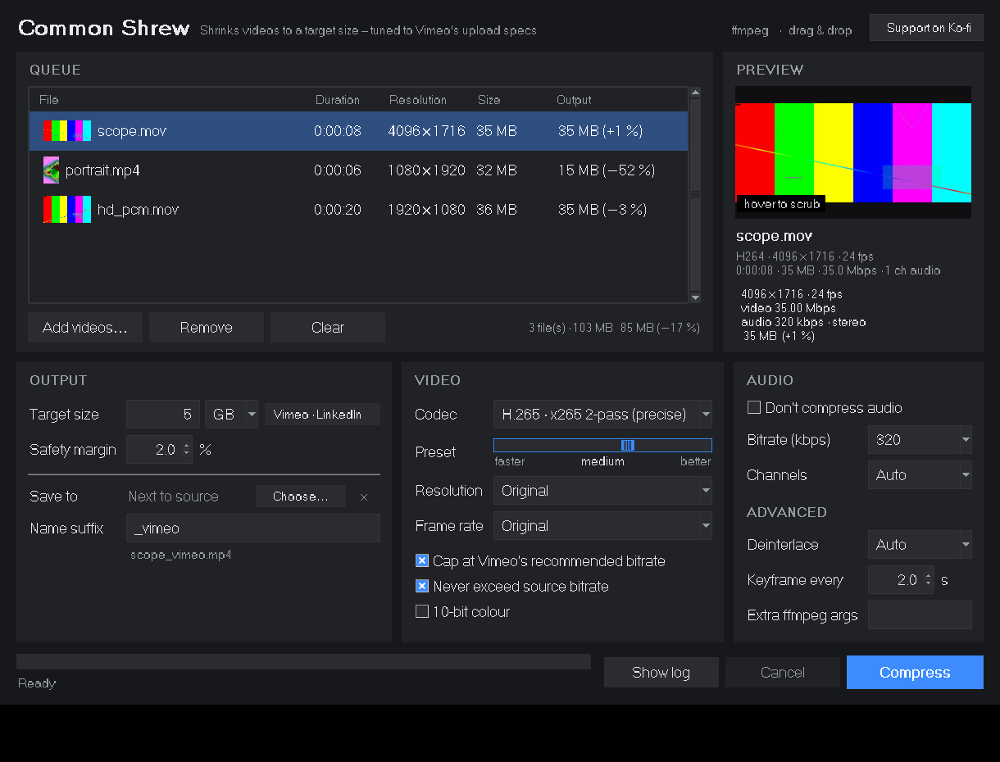

[](https://ko-fi.com/S7Z228X1UL)

A small desktop app for macOS, Windows and Linux (Python + Tkinter, powered by ffmpeg) that compresses one or many videos so
each file ends up just below a chosen size – 5 GB by default – while following Vimeo's
recommended compression settings.



> Named after *Sorex araneus*, the [common shrew](https://en.wikipedia.org/wiki/Common_shrew). To survive winter it shrinks its body by
> about 18 %, its skull by around 15 % and its brain by up to 20–30 %, then grows back in
> spring ([Dehnel's phenomenon](https://en.wikipedia.org/wiki/Dehnel%27s_phenomenon)).
> This shrinks your files to conform to arbitrary limits. Your originals stay untouched.

## Features

- **Hits a target size.** Calculates the bitrate from the size and duration and encodes in
  2 passes, so the result lands just under the limit. A safety margin is
  configurable.
- **Size presets** for common upload limits: Vimeo, LinkedIn, Facebook, TikTok, Telegram,
  WhatsApp, Pinterest, Threads, X, Discord and e-mail. You can also enter any value in GB
  or MB.
- **Vimeo recommendations:**
  - H.264/H.265, progressive, constant frame rate of 60 fps or less.
  - Bitrate ceilings per resolution.
  - AAC 320 kbps / 48 kHz audio. If a video has no sound, a silent track is added.
  - Square pixels and BT.709 colour tags. HDR sources keep their metadata and use 10-bit.
- **Resizing never crops.** The video is fitted inside the chosen box (4K, 2K, 1080p,
  720p, SD) and keeps its aspect ratio. Portrait videos use the rotated box. Nothing is
  upscaled.
- **"Don't compress audio"** keeps the original track. Files with PCM audio are saved as `.mov`.
- **Never exceeds the source bitrate**, so efficient sources don't get bigger.
- **H.265 by default**, for the best quality at a given size (x265, preset `medium`). x264 is
  available for maximum compatibility.
- **Apple hardware decoding** (macOS) speeds up both passes, especially for HEVC and ProRes
  sources, and falls back to software automatically.
- **Apple hardware encoding** (VideoToolbox, macOS) for fast results.
- **Desktop app:**
  - Queue with drag & drop and thumbnails.
  - Hover-scrub preview: move the mouse across the thumbnail to check you've got the
    right clip.
  - Preview of the chosen file, with the estimated size and compression before you start.
  - The actual size and reduction in % after encoding.
  - Tooltips for every option, a progress bar and a log.

## Install & run

Common Shrew runs on **macOS, Windows and Linux**. Download or clone this repository, then
start the launcher for your system. Each launcher checks what's missing and asks before it
installs anything.

### macOS
Double-click **`Common Shrew.command`**. The first time, use right-click → Open, because
macOS blocks unsigned scripts. It offers to install:
- **Homebrew**, if needed.
- **ffmpeg** via Homebrew.
- **python-tk** via Homebrew. Apple's built-in Tk is outdated and draws blank widgets.
- **tkinterdnd2** for drag & drop, into a local `.venv` folder.

### Windows
Double-click **`Common Shrew.bat`**. It offers to install:
- **Python 3**, via winget. The python.org installer already includes Tkinter.
- **ffmpeg**, via winget (`Gyan.FFmpeg`).
- **tkinterdnd2** for drag & drop.

The app then starts without a console window.

### Linux
Run **`./common-shrew.sh`**. It offers to install, via apt, dnf, pacman or zypper (with
`sudo`):
- **ffmpeg**.
- **Tkinter** (`python3-tk`).
- **tkinterdnd2** for drag & drop.

On Fedora, the full ffmpeg with x264/x265 comes from
[RPM Fusion](https://rpmfusion.org/Configuration).

### Manual setup

```sh
# macOS
brew install ffmpeg python-tk
# Windows (PowerShell)
winget install Gyan.FFmpeg          # Python from python.org includes Tkinter
# Debian/Ubuntu
sudo apt install ffmpeg python3-tk python3-venv

python3 -m venv .venv
.venv/bin/pip install tkinterdnd2   # optional: drag & drop  (Windows: .venv\Scripts\pip)
.venv/bin/python common_shrew.py    # Windows: .venv\Scripts\pythonw common_shrew.py
```

Apple hardware encoding and decoding (VideoToolbox) are only offered on macOS. On Windows
and Linux, Common Shrew uses the x265/x264 software encoders, which are also the default
on the Mac.

## Command line

```sh
python3 common_shrew.py --cli movie.mov                    # 5 GB, H.265, Vimeo defaults
python3 common_shrew.py --cli *.mov --size 750MB --res 1080
python3 common_shrew.py --cli movie.mov --codec hevc_videotoolbox --copy-audio
python3 common_shrew.py --cli movie.mov --dry-run          # show plan + ffmpeg command
python3 common_shrew.py --cli --help
```

## Notes

- Sizes are decimal: 1 GB = 1,000 MB = 1,000,000,000 bytes.
- Platform limits change often, and many platforms also limit duration. The presets
  reflect limits as of November 2026.
- Output files go next to the source, or to a chosen folder, named `<name>_vimeo.mp4`.

## Support

Common Shrew is free. If it saves you time, you can buy me a coffee:

[](https://ko-fi.com/S7Z228X1UL)

## License

[MIT](LICENSE) © 2026 sonarkon

Common Shrew calls [ffmpeg](https://ffmpeg.org) as an external program. ffmpeg is not
bundled and has its own (L)GPL licence.

## Artwork

The shrew illustration on the banner is an engraving by C. Butterworth from the
*Encyclopædia Britannica*, 9th ed., vol. XXI (1886). It is in the public domain and comes
from [Wikimedia Commons](https://commons.wikimedia.org/wiki/File:EB9_Shrew.jpg). See
[docs/banner](docs/banner/) for how to rebuild the banner.

## Sources

- [Vimeo – Video compression settings](https://help.vimeo.com/hc/en-us/articles/12426982098449-Video-compression-settings)
- [Sprout Social – Social media video specs](https://sproutsocial.com/insights/social-media-video-specs/)
- [Smithsonian – Shrews' skulls and brains shrink in winter](https://www.smithsonianmag.com/smart-news/shrews-skull-and-brain-shrink-winter-1-180966922/)
